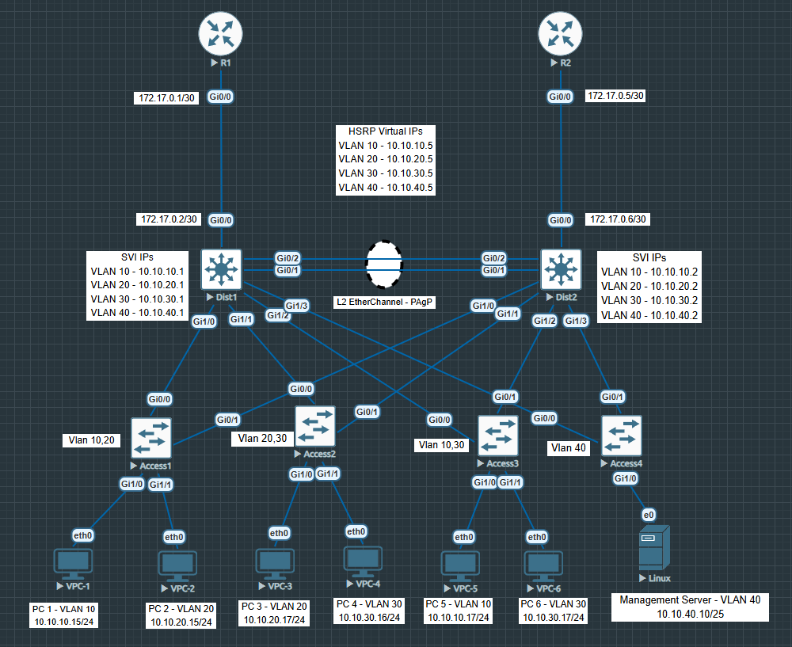

# Network Design Lab - CCNA Exercise

A three-tier campus network built in EVE-NG with redundant distribution switches, inter-VLAN routing, OSPF, HSRP gateway redundancy, Rapid PVST+, and a Linux (Kea) DHCP server reached through DHCP relay.

I will expand it to include a data center hosting servers and other networks.

Credentials have been removed from all configuration files and screenshots of `show` commands are stored in [Images](./images) folder.

## I. Objectives

- Build a hierarchical campus design (core, distribution, access)
- Provide first-hop redundancy for four VLANs with HSRP
- Align Layer 2 (spanning tree root) and Layer 3 (HSRP active) on the same multilayer switch
- Route between VLANs on the distribution layer and exchange routes with OSPF
- Apply access-layer protections like Port Security, Portfast and BPDU Guard
- Serve DHCP for multiple VLANs from a single Linux server using DHCP relay

## II. Environment

| Item | Detail |
|---|---|
| Platform | EVE-NG Community Edition running as a VM on VMware ESXi |
| Routers | Cisco IOSv (IOS 15.7) |
| Switches | Cisco IOSvL2 (IOS 15.2) |
| Endpoints | VPC hosts, Ubuntu 20.04 (DHCP server using Kea) |

Cisco images are not included in this repo. They are licensed software and must be obtained separately.

## III. Topology Description

| Layer | Devices | Role |
|---|---|---|
| Core | R1, R2 | Routed uplinks to the distribution layer, OSPF area 0 |
| Distribution | Dist1, Dist2 | Multilayer switches: SVIs, HSRP, OSPF area 0, STP root/secondary |
| Access | Access1, Access2, Access3, Access4 | Layer 2 switches: access ports, port security, PortFast + BPDU Guard |

### 1. Screenshot of the design



### 2. Core Layer: R1, R2

- OSPF process 1, area 0, point-to-point links to the distribution layer
- Router IDs 1.1.1.1 (R1) and 2.2.2.2 (R2)
- CDP enabled
- Startup configs stored in [Routers](./configs/routers)

### 3. Distribution Layer: Dist1, Dist2

- SVIs for VLANs 10, 20, 30, 40 with HSRP (VIP ends in `.5`)
- Dist1 is HSRP active (priority 110, preempt) and STP root (priority 24576); Dist2 is standby and secondary root (priority 28672)
- Two-link EtherChannel between Dist1 and Dist2 (PAgP: desirable/auto)
- OSPF area 0 on SVIs and routed links; static default route to the connected router
- `ip helper-address` configured on VLANs 10, 20, 30 and pointing to the DHCP server
- Rapid PVST+, VTP transparent, CDP enabled
- Startup configs stored in [Distribution switches](./configs/distribution)

### 4. Access Layer: Access1-4

- 802.1Q trunks to both distribution switches, with per-link allowed VLAN lists
- Rapid PVST+, VTP transparent, CDP enabled on uplinks
- Host ports: port security (sticky MAC, max 2), PortFast, BPDU Guard
- Access4 hosts the Linux server in VLAN 40
- Startup configs stored in [Access switches](./configs/access)

## IV. Addressing

### 1. VLANs and subnets

| VLAN | Name | Subnet | Dist1 SVI | Dist2 SVI | HSRP VIP | DHCP Pool |
|---|---|---|---|---|---|---|
| 10 | none | 10.10.10.0/24 | 10.10.10.1 | 10.10.10.2 | 10.10.10.5 | .15 - .250 |
| 20 | none | 10.10.20.0/24 | 10.10.20.1 | 10.10.20.2 | 10.10.20.5 | .15 - .250 |
| 30 | none | 10.10.30.0/24 | 10.10.30.1 | 10.10.30.2 | 10.10.30.5 | .15 - .250 |
| 40 | SERVERS | 10.10.40.0/25 | 10.10.40.1 | 10.10.40.2 | 10.10.40.5 | static (server at 10.10.40.10) |
| 199 | NATIVE | none | none | none | none | none |

### 2. Routed links

| Link | Side A | Side B |
|---|---|---|
| R1 to Dist1 | R1 Gi0/0 172.17.0.1/30 | Dist1 Gi0/0 172.17.0.2/30 |
| R2 to Dist2 | R2 Gi0/0 172.17.0.5/30 | Dist2 Gi0/0 172.17.0.6/30 |

### 3. Switch connectivity

| Distribution port | Dist1 | Dist2 | Access uplinks |
|---|---|---|---|
| Gi0/1 - Gi0/2 | Port-channel1 | Port-channel1 | (inter-distribution) |
| Gi1/0 | Access1 | Access1 | Access Gi0/0 to Dist1, Gi0/1 to Dist2 |
| Gi1/1 | Access2 | Access2 | Same |
| Gi1/2 | Access3 | Access3 | Same |
| Gi1/3 | Access4 | Access4 | Same |

### 4. VLANs per access switch

| Switch | Trunk allowed VLANs | Gi1/0 | Gi1/1 |
|---|---|---|---|
| Access1 | 10, 20, 40 | VLAN 10 host | VLAN 20 host |
| Access2 | 20, 30, 40 | VLAN 20 host | VLAN 30 host |
| Access3 | 10, 30, 40 | VLAN 10 host | VLAN 30 host |
| Access4 | 10, 20, 30, 40 | VLAN 40 (Linux server) | Unused |

## V. Key Design Decisions

- **Native VLAN 199, not allowed on trunks.** A dedicated unused native VLAN, excluded from the allowed list, keeps untagged traffic off the trunks.
- **Dist1 is both STP root and HSRP active.** This keeps the Layer 2 forwarding path and the Layer 3 gateway on the same switch.
- **Trunk pruning per access switch.** Each uplink carries only the VLANs that switch needs (Access4 carries all four).
- **DHCP relay instead of a server per VLAN.** Both distribution switches relay DHCP to the Linux server in VLAN 40.
- **Port Security**. MAC Addresses are learned dynamically (***sticky***), and 2 addresses maximum can be learned.
- **PortFast with BPDU Guard on host ports only.** Edge ports come up quickly, and an unexpected switch is blocked.
- **VTP transparent mode.** VLANs are defined locally on each switch.

## VI. DHCP Server (Kea)

The Linux server in VLAN 40 (10.10.40.10) runs Kea DHCPv4 on interface `ens3` with a memfile lease database. It serves three subnets (VLANs 10, 20, 30), each with a pool of `.15 - .250` and the HSRP VIP as default gateway. See [`configs/dhcp/kea-dhcp4.conf`](configs/dhcp/kea-dhcp4.conf).

## VII. Planned Additions/Changes

- Change HSRP VIPs from `.5` to `.1`. SVI addresses will be renumbered; Kea gateway options will be updated to match the changes
- Change the EtherChannel link to use LACP instead of PAgP
- All VLANs will be named, VLAN 40 will no longer host any server and each distribution switch will be the active router for each pair of VLANs (Dist1 will be the active router for VLANs 10 & 20)
- DHCP snooping and Dynamic ARP Inspection
- Access Control Lists to filter network packets
- Router interconnect and an upstream/NAT edge
- A data center that hosts servers like DHCP, DNS, Syslog

## VIII. Repository Layout

```text
├── images/
├── configs/
│   ├── routers/
│   ├── distribution/
│   ├── access/
│   └── dhcp/
└── README.md
```
